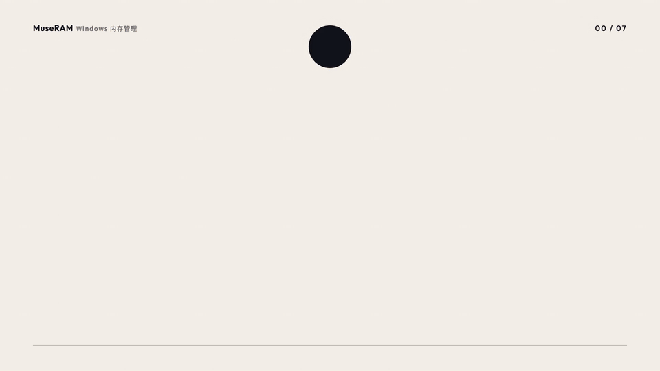
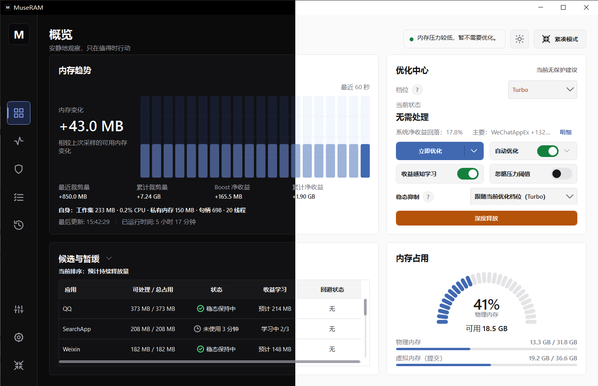
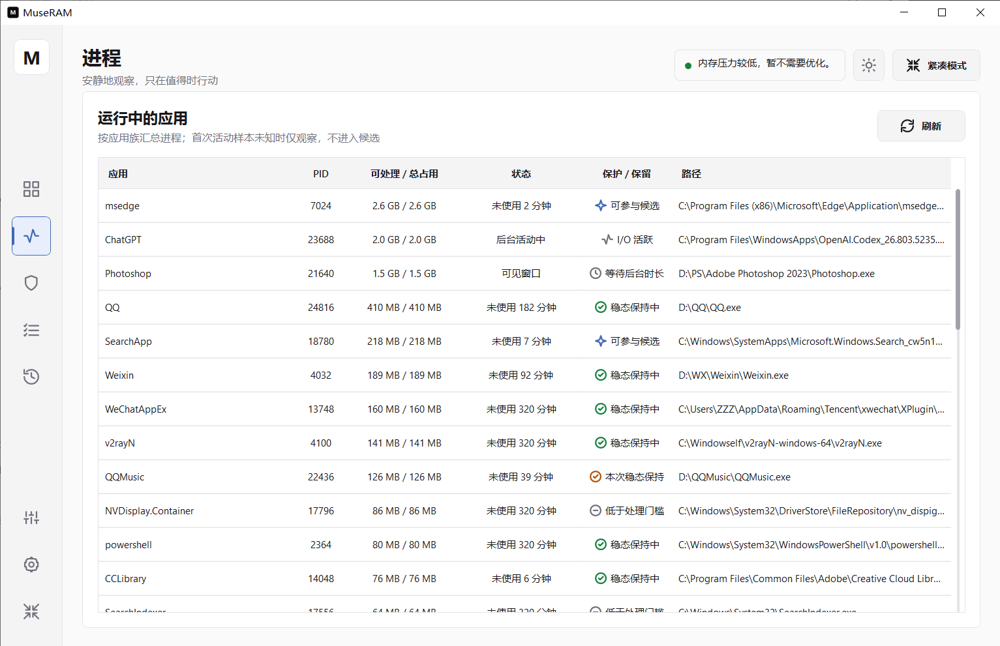
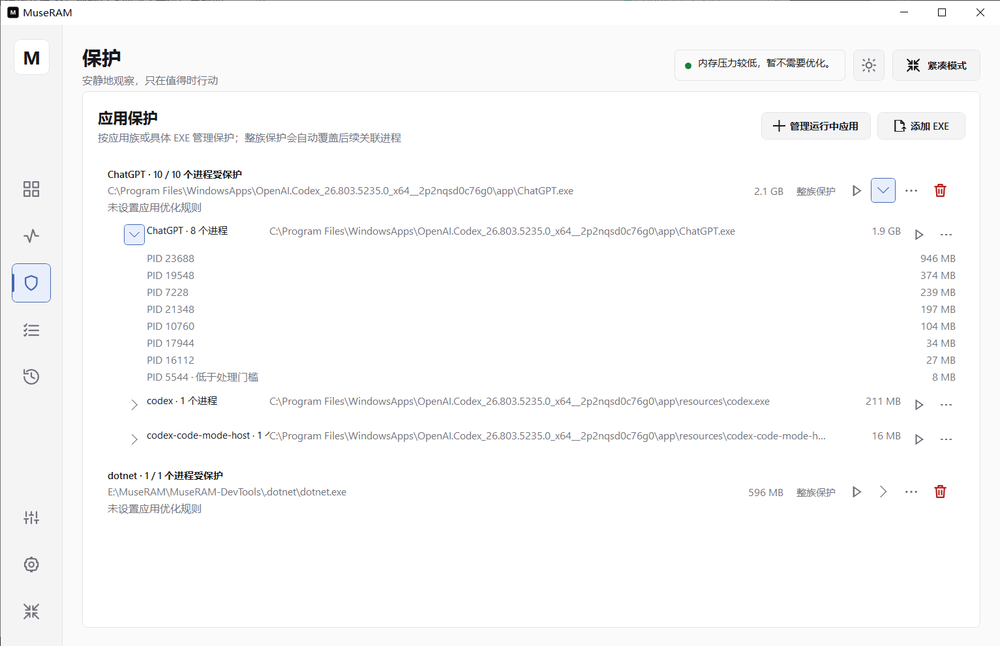
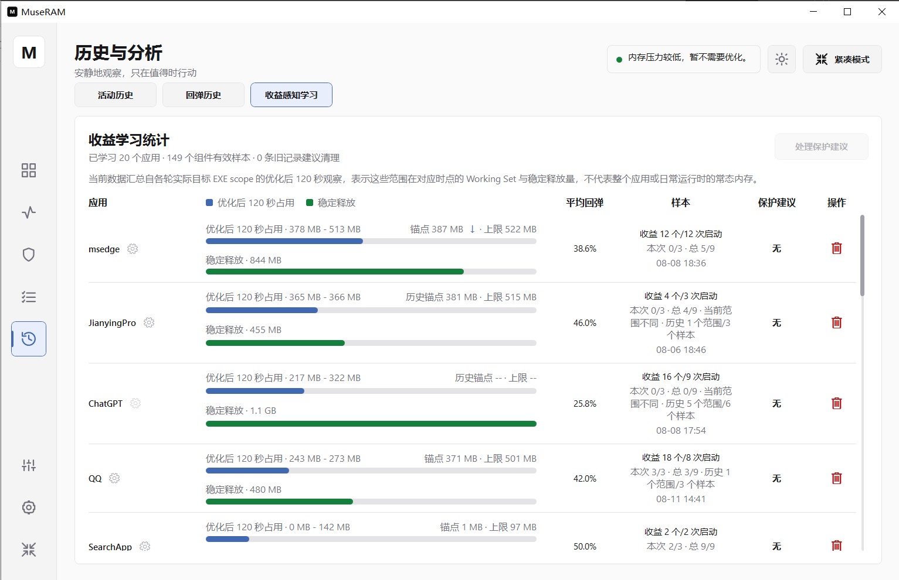
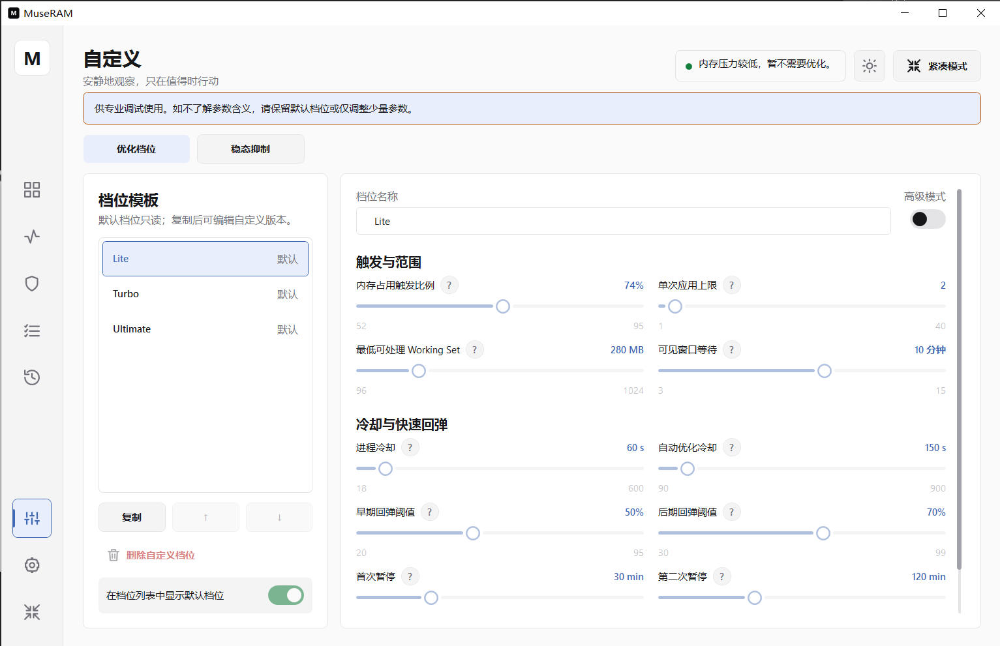

# MuseRAM

[简体中文](./README.md) | [English](./README.en.md)

**A Windows memory manager for gamers and power users: see the memory pressure first, decide what to do about it, and get honest numbers on what actually changed.**

### [⬇ Download the latest release](https://github.com/Zeilyintro/MuseRAM/releases/latest)

MuseRAM quietly observes system activity, helps identify background applications suitable for optimization, and reduces memory usage while minimizing disruption to your work.

## Why MuseRAM

- **No inflated numbers**: MuseRAM shows both the working-set reduction of processes and the real change in system-available memory, so you can judge whether an optimization actually mattered.
- **Protection for what matters**: Games, creative tools, and work apps can be protected as a whole or by specific executables, and are never touched automatically.
- **Every decision is visible**: The candidate list shows which applications are eligible for optimization, which are deferred, and why.
- **Learns, with restraint**: It records how past optimizations performed for each app to inform later decisions. Settings and data stay on your machine.

> MuseRAM has goals similar to [Mem Reduct](https://github.com/henrypp/memreduct) and other tools. Mem Reduct is a mature, lightweight open-source memory cleaner; MuseRAM takes a different approach with transparent candidate decisions, per-application protection, and honest reporting of optimization results. Choose whichever suits how you work.

See the [CHANGELOG](./CHANGELOG.md) and [Releases](https://github.com/Zeilyintro/MuseRAM/releases) for recent changes.

## Main Features

- **Clear memory overview**: View memory usage, recent changes, optimization results, and MuseRAM's own resource usage in one place.
- **Manual or automatic optimization**: Optimize immediately or let MuseRAM act automatically according to the current system state.
- **Global reclaim**: Quickly reclaim memory used by unprotected background processes when you need to free more memory in a short time.
- **Transparent candidate decisions**: See which applications are eligible for optimization and why others are temporarily deferred.
- **Application protection**: Protect an entire application or only selected executables within it.
- **Benefit learning**: Learn from previous optimization results to make future decisions better suited to real usage.
- **Multiple profiles**: Choose Lite, Turbo, or Ultimate, or adjust a custom profile to suit your needs.
- **Light and dark themes with Chinese and English interfaces**: Follow the Windows theme or switch manually.

## Interface Preview

### Running Processes

View running applications, their current status, and whether they are protected or retained.

### Application Protection

Protect an entire application or selected executables, and expand an entry to view related processes.

### Benefit Learning

Review historical optimization results, stable memory release, and sample progress for each application.

### Custom Profile

Adjust optimization scope, waiting periods, and other preferences beyond the built-in profiles.

## Download and Use

1. Visit [GitHub Releases](https://github.com/Zeilyintro/MuseRAM/releases) and download the portable `MuseRAM.zip` or the standalone `MuseRAM.exe`.
2. Extract the portable package and run it. A permanent folder is recommended.
3. Grant administrator permission when prompted by Windows.
4. For your first use, keep the default settings and protect important applications used for work, creative tasks, or games.

Requirements:

- 64-bit Windows 10 or Windows 11
- 64-bit .NET 8 Desktop Runtime
- Administrator permission when performing memory optimization

## Usage Notes

Regular memory optimization does not close applications. However, an application may reload content or respond briefly when that content is used again. Protect applications that are editing documents, creating content, or running important tasks.

Deep Release is different from regular optimization. It is intended for background applications you have confirmed are no longer needed. Check for unsaved work before using it.

Global reclaim bypasses some normal limits to free more background memory quickly without closing applications. It may cause more noticeable memory rebound or reloading later, so protect important applications first.

## Local Data and Privacy

MuseRAM stores settings, protection rules, history, and learning data locally. Diagnostic data collection is disabled by default. When enabled manually, diagnostics are written only to local files and are never uploaded automatically.

## Current Status

MuseRAM is still in beta. The interface, default settings, and some behavior may continue to change. Start with the default profiles and report reproducible problems through [GitHub Issues](https://github.com/Zeilyintro/MuseRAM/issues).

When reporting an issue, include the MuseRAM version, Windows version, steps leading to the problem, and relevant screenshots when possible. Remove usernames, file paths, and other private information before sharing screenshots or logs.
